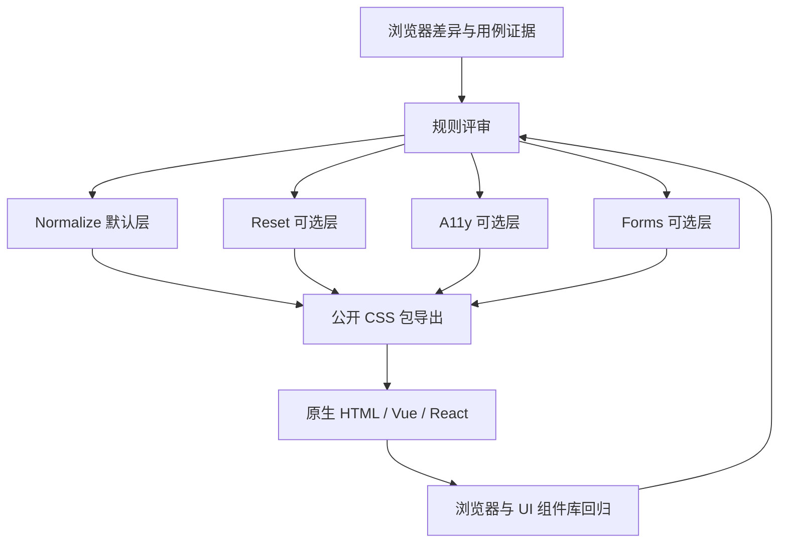

# ARCHITECTURE — 总体架构

**状态**：规划中，尚无源码与构建系统。本文描述拟议方向而非当前实现。  
**关联**：[需求](REQUIREMENTS.md) · [SDD](SDD.md) · [ADR-0001](adr/0001-css-base-strategy.md)

## 1. 架构目标和质量属性

- **规范化与重置分离**：默认规则只纠正可复现的浏览器差异；高侵入性行为显式选择。
- **可组合**：使用者可以选择 Normalize，或进一步选择 Reset、A11y、Forms 等独立能力。
- **可审计**：以规则证据、浏览器对照用例、兼容性回归和变更记录支撑发布。
- **可覆盖**：降低选择器特异性；评估 CSS Cascade Layers 的顺序、未分层规则优先级。
- **无运行时业务耦合**：候选产物为静态 CSS，不承担路由、API、认证、存储、运行时状态管理。

## 2. 拟议逻辑架构



这是**设计流程图**，图中没有任何已经存在的构建脚本或生产部署服务。

## 3. 模块职责与依赖（拟议）

| 逻辑模块 | 职责 | 禁止承担的职责 |
| --- | --- | --- |
| Normalize | 修正有证据的浏览器默认差异 | 主题设计、全局布局意见、表单视觉体系 |
| Reset | 按需清理布局/盒模型默认值 | 无条件被默认入口引入 |
| A11y | 辅助键盘焦点及用户系统偏好 | 以不可覆盖方式取消页面动效 |
| Forms | 针对原生控件的可选体验改善 | 强制替换第三方 UI 控件设计 |
| Package exports | 暴露明确、稳定的公共 CSS 入口 | 在用户未知情时注入其他模块 |
| Validation | 静态规则、浏览器矩阵与对比报告 | 用静态字符串测试代替真实兼容性测试 |

模块默认**逻辑上独立**；最终物理文件与产物由 SDD 评审确定。

## 4. 层级与覆盖设计（候选）

```css
@layer adui.normalize, adui.reset, adui.a11y, adui.forms;
```

同一个 origin、importance 下，未分层的普通样式通常优先于分层普通样式，这有助于消费者覆盖。但必须明确处理层声明先后、可选入口的统一层顺序、第三方框架自身 layers、`!important` 反转等问题。**以上仅是设计提案，尚未在浏览器验证。** [ADR-0002](adr/0002-cascade-layers.md) 同时讨论首版不内建 Layers 的候选方案，仍未接受。

## 5. 浏览器、生态与部署边界

- 目标是现代 Chromium、Firefox、WebKit；最低支持版本、Android/iOS WebView 边界未决。
- 面向多种构建环境；不能因为支持 Vite 就假定无需验证 Webpack、SSR 构建或 CSS 导入路径。
- 原生 HTML、Vue、React 只是**使用场景**，不是本库的运行时框架依赖。
- 预期发布介质是 npm 静态 CSS 包（尚未发布）；无需数据库、缓存、后端服务、环境变量、账号认证和外部 API。
- 许可证已确认为 MIT，第三方来源授权仍须逐项核查。

## 6. 安全、性能、观测与故障处理

- 安全：不得在发布 CSS 中隐藏外部跟踪、加载非必要第三方远程资源或内置不可信脚本；核查源码来源和依赖供应链。
- 性能：规则最小化；按各个入口记录体积与变化；不预先编造性能提升数据。
- 观测：后续以测试报告、视觉回归截图、浏览器版本和发布清单追踪，不涉及运行时遥测。
- 故障处理：出现样式回归时定位入口 → 规则 → 浏览器 → UI 场景 → 关联需求/提交，必要时移除单条规则而非整体叠加覆盖。

## 7. 技术选型与待决策

| 事项 | 当前状态 | 决策依据 |
| --- | --- | --- |
| 纯 CSS、无运行时 JS | 候选方向 | 降低宿主框架耦合 |
| npm 包名 `@adui/normalize.css` | 项目目标已明确 | 与仓库定位一致；发布权限待确认 |
| CSS Cascade Layers | 候选 | 控制规则层级，但需多入口与跨库验证 |
| CSS 构建/压缩工具 | 未选型 | 先明确可执行验证需求，不提前锁版本 |
| 本地浏览器自动化 | 未选型 | 定义浏览器与 Fixtures，再选本地执行工具；**不增加 CI** |
| 首版包含哪些增强模块 | 待评审 | [ADR-0003](adr/0003-mvp-package-contract.md) 对比最小默认入口与可选模块同版发布的取舍 |

## 8. ADR 索引

- [ADR-0001：CSS 基础策略与模块边界](adr/0001-css-base-strategy.md) — **Proposed**；尚未接受。
- [ADR-0002：默认是否使用 Cascade Layers](adr/0002-cascade-layers.md) — **Proposed**；尚未接受。
- [ADR-0003：首版 MVP 模块与包导出边界](adr/0003-mvp-package-contract.md) — **Proposed**；建议最小公开入口，尚未接受。

**更新约定**：模块职责、技术选型、对外依赖和浏览器支持矩阵变化时更新本文件与 ADR，并评估 SDD/需求影响。