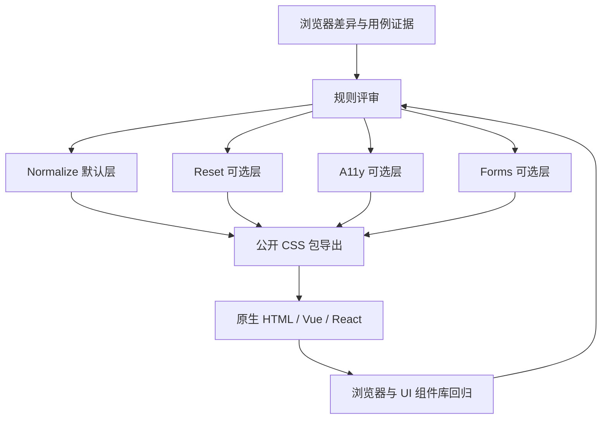

# ARCHITECTURE — 总体架构

**状态**：首版设计决策已批准；开发分支已有 W-03 测试基础设施、首条 R-003 正式 CSS 源码、静态 CSS 构建脚本及单一根 exports；尚未完成正式发布验收或 npm 发布。  
**关联**：[需求](REQUIREMENTS.md) · [SDD](SDD.md) · [ADR-0001](adr/0001-css-base-strategy.md)

## 1. 架构目标和质量属性

- **规范化与重置分离**：默认规则只纠正可复现的浏览器差异；高侵入性行为显式选择。
- **可组合（长期架构）**：首版仅默认 Normalize；Reset、A11y、Forms 独立入口延后至未来版本单独评审。
- **可审计**：以规则证据、浏览器对照用例、兼容性回归和变更记录支撑发布。
- **可覆盖**：降低选择器特异性；评估 CSS Cascade Layers 的顺序、未分层规则优先级。
- **无运行时业务耦合**：候选产物为静态 CSS，不承担路由、API、认证、存储、运行时状态管理。

## 2. 拟议逻辑架构

这是**设计流程图**，图中没有任何已经存在的构建脚本或生产部署服务。

## 3. 模块职责与依赖（拟议）

| 逻辑模块        | 职责                           | 禁止承担的职责                       |
| --------------- | ------------------------------ | ------------------------------------ |
| Normalize       | 修正有证据的浏览器默认差异     | 主题设计、全局布局意见、表单视觉体系 |
| Reset           | 按需清理布局/盒模型默认值      | 无条件被默认入口引入                 |
| A11y            | 辅助键盘焦点及用户系统偏好     | 以不可覆盖方式取消页面动效           |
| Forms           | 针对原生控件的可选体验改善     | 强制替换第三方 UI 控件设计           |
| Package exports | 暴露明确、稳定的公共 CSS 入口  | 在用户未知情时注入其他模块           |
| Validation      | 静态规则、浏览器矩阵与对比报告 | 用静态字符串测试代替真实兼容性测试   |

模块默认**逻辑上独立**；最终物理文件与产物由 SDD 评审确定。

## 4. 已接受的默认 CSS 级联策略

依据 [ADR-0002 Accepted](adr/0002-cascade-layers.md)，首版默认 Normalize CSS **不内置 `@layer`**；只在有证据的规则上逐条考虑 `:where()`。不要在默认入口自动创建命名层，也不要为了增加覆盖性而使用 `!important`。未来如需对外提供分层变体必须另行决策和验证。**此处是架构约束，非已经通过浏览器测试的结论。**

## 5. 浏览器、生态与部署边界

- 依 [ADR-0004 Accepted](adr/0004-browser-support-policy.md) 固定 Baseline 2023 为 CSS 特性准入参考；Chrome/Edge 120、Firefox 121、Safari 17.2 等为已批准的最低**测试目标**，非已发布支持范围；系统 WebView 按实际设备另行确认。
- 开发工具链已按 [ADR-0005](adr/0005-viteplus-toolchain.md) 选定 **Vite+**；CSS 仍应是无运行时 JS 依赖的独立文件。不能因为在 Vite+ 中构建通过就假定无需验证 Webpack、SSR 构建或原生 CSS 导入路径。
- 原生 HTML、Vue、React 只是**使用场景**，不是本库的运行时框架依赖。
- 预期发布介质是 npm 静态 CSS 包（尚未发布）；无需数据库、缓存、后端服务、环境变量、账号认证和外部 API。
- 许可证已确认为 MIT，第三方来源授权仍须逐项核查。

## 6. 安全、性能、观测与故障处理

- 安全：不得在发布 CSS 中隐藏外部跟踪、加载非必要第三方远程资源或内置不可信脚本；核查源码来源和依赖供应链。
- 性能：规则最小化；按各个入口记录体积与变化；不预先编造性能提升数据。
- 观测：后续以测试报告、视觉回归截图、浏览器版本和发布清单追踪，不涉及运行时遥测。
- 故障处理：出现样式回归时定位入口 → 规则 → 浏览器 → UI 场景 → 关联需求/提交，必要时移除单条规则而非整体叠加覆盖。

## 7. 技术选型与待决策

| 事项                           | 当前状态                   | 决策依据                                                                  |
| ------------------------------ | -------------------------- | ------------------------------------------------------------------------- |
| 纯 CSS、无运行时 JS            | 候选方向                   | 降低宿主框架耦合                                                          |
| npm 包名 `@adui/normalize.css` | 项目目标已明确             | 与仓库定位一致；发布权限待确认                                            |
| CSS Cascade Layers             | 首版默认不内置（Accepted） | ADR-0002；逐条评估 `:where()` 和覆盖风险                                  |
| 开发工具链                     | **Vite+（Accepted）**      | [ADR-0005](adr/0005-viteplus-toolchain.md)；开发期统一 Vite+，无运行时 JS |
| 纯 CSS 库打包方式              | **已切换 Vite+ 构建方案**  | `vp build` CSS-only 入口待本机验证；`vp pack` 单独试验，消费端未验收      |
| 具体 Vite+ 版本与包管理器      | 未冻结                     | 获开发授权后核对环境、锁文件与最小依赖                                    |
| 本地浏览器自动化               | 未选型                     | 定义浏览器与 Fixtures，再选本地执行工具；**不增加 CI**                    |
| 首版包含哪些增强模块           | 已决定：只含 Normalize     | ADR-0003；Reset/Forms/A11y/all.css 延后                                   |

## 8. ADR 索引

- [ADR-0001：CSS 基础策略与模块边界](adr/0001-css-base-strategy.md) — **Accepted**。
- [ADR-0002：默认不内置 Cascade Layers](adr/0002-cascade-layers.md) — **Accepted**。
- [ADR-0003：首版只提供默认 Normalize 入口](adr/0003-mvp-package-contract.md) — **Accepted**。
- [ADR-0004：固定 Baseline 2023 特性准入参考](adr/0004-browser-support-policy.md) — **Accepted**；[映射研究](research/BASELINE_2023_MAPPING.md) 已得到候选版本，实际最低支持声明仍未冻结。
- [ADR-0005：开发工具链统一采用 Vite+](adr/0005-viteplus-toolchain.md) — **Accepted**；尚未安装或运行。
- [MVP 实施计划](plans/MVP_IMPLEMENTATION_PLAN.md) — 可执行的任务与验收门槛；**尚未开发**。

**2026-11-04 实施说明**：默认 CSS 的首条可追踪规则为 R-003（`b, strong { font-weight: bolder; }`），R-004 不加入；`src/normalize.css` 的开发期产物改为通过 `vp build` 的 CSS-only Vite 库构建生成目标 `dist/normalize.css`，对外仍仅 `exports["."]`。`vp dev` 继续服务 Fixture；`vp pack` 在单独 `dist-pack/` 实验 tsdown 直接 CSS 入口，不能覆盖正式根导出。迁移配置尚未在支持版本的 Windows Vite+ 中验证，不能宣称其已通过。当前保留 `private: true`，WebKit、组件库和生产消费者未做完整验收。

**更新约定**：模块职责、技术选型、对外依赖和浏览器支持矩阵变化时更新本文件与 ADR，并评估 SDD/需求影响。
