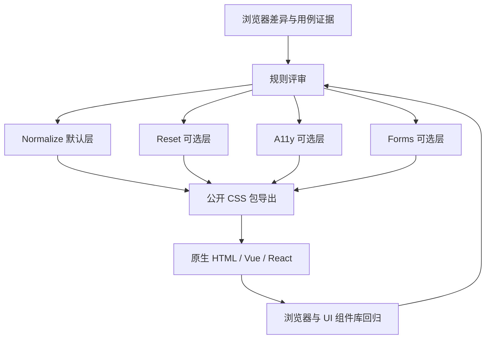

# ARCHITECTURE — 总体架构

**2026-11-06 · `v0.0.3` 已发布架构（当前事实）**：正式 CSS-only npm 包提供默认 Normalize 与四个显式可选模块入口（Reset、Forms、A11y、All），另有 `/normalize.css` 默认别名；`src/normalize.css` 的三条规则由 Vite+ `vp pack` 构建成 `dist/normalize.css`，四个可选模块从 `src` 直接分发，`all.css` 只使用标准相对 CSS `@import` 组合。已验收发行源码 `f5c08642e1ab6eaa1cb3d84782485f0298ae77be` 的本机测试 61/61 通过，npm/Git Tag/GitHub Release 皆已发行；不增加运行时 JavaScript、依赖或 CI。此前“首版仅根导出、可选模块尚未实现、版本待发行”的描述都是历史设计阶段；跨浏览器、移动端及 UI 组件库完整矩阵仍未全部验证。

**2026-11-05 · `0.0.3` 模块化架构实施（最新开发候选）**：维持保守的默认 Normalize (`src/normalize.css` → `vp pack` → `dist/normalize.css`) 与现有 CSS-only 根入口；四个新增源码 `reset.css` / `forms.css` / `a11y.css` / `all.css` 通过显式 CSS 子路径导出并随 npm `src` 目录打包，`all.css` 仅借助原生相对 `@import` 串联模块。没有额外 Node 构建脚本、打包器、运行时 JS、第三方依赖或 CI；使用者能按需选模块，默认没有 Reset/Forms/A11y 的副作用。这是维护者要求一次性交付整套的**待验证实现**，不能将新模块预先视为已在 npm `0.0.2` 发布；后续版本、浏览器最低支持和 npm/Tag/Release 仍独立审核。旧版“全部可选模块仅设计/未公开”的段落属于之前阶段事实。

**2026-11-05 · 默认模块架构范围冻结（当前决定）**：维护者确认默认 Normalize 以已合并的 R-003、R-007、R-008 为当前完整规则集合；低侵入、CSS-only、无运行时 JS、单一根入口、不使用默认 `@layer` 等架构边界不变。Reset/Forms/A11y 保持后续显式可选模块方向，未实现/未公开导出。本决定不扩大已验证浏览器范围，不调整 `0.0.2` 或授权 `0.1.0`/发行，禁止新增 CI；见 [冻结记录](research/DEFAULT_NORMALIZE_V01_READINESS.md)。

**2026-11-05 · 当前主分支与回归扩展（最新）**：PR #19 已按维护者批准合并，`main` 默认 `src/normalize.css` 包含 R-003、R-007、R-008 三条规则；`package.json` 仍为 `0.0.2/private:false`，npm 已发布 `0.0.1`。本次仅扩展 T0/T2 验收覆盖（12→15 个探针），测试无 `title` 缩写与作者明示的缩写/表格样式能否优先于低特异性 `:where()`；完整覆盖矩阵见 [默认 Normalize 完整性门槛](research/DEFAULT_NORMALIZE_V01_READINESS.md)。此前 W-05 首版决议保留历史效力，暂缓项不因竞品存在就自动准入；`0.1.0` 只在默认 Normalize 完成且维护者验收后采用。当前尚无最新提交完整 Windows/Vite+ 与浏览器回归的实测日志，不增加 CI。

**状态（2026-11-04）**：首版设计决策及 [W-05 的 36 条规则首版去留](research/W05_RULE_ACCEPTANCE.md) 均已由维护者批准；开发分支唯一默认规则 R-003 已实现，W-06 已正式验收归档。静态 CSS 构建与唯一根 exports 保持不变；W-07 发行前质量审核、对外兼容性承诺及 npm 发布仍是独立事项，均不因规则评审通过而自动完成。  
**关联**：[需求](REQUIREMENTS.md) · [SDD](SDD.md) · [ADR-0001](adr/0001-css-base-strategy.md)

**W-07 发行配置变更（2026-11-05）**：维护者确定首发候选 `0.0.1`、`private:false`；这是 npm manifest 和包契约测试变更，不影响单一 Normalize CSS 根入口、R-003 产品规则、Vite+ 静态交付方式及未来可选模块设计。尚未 npm 发布，不新增 CI，也不合并主分支。此前文中 `private:true` 的 2026-11-04 记录为历史实施状态。详见 [W-07 审核](research/W07_RELEASE_READINESS_REVIEW.md)。

**2026-11-05 · W-07 发行安全开关最新决定**：保持首发候选版本 `0.0.1`，将 `private` 恢复为 `true`；先前 `private:false` 记录为历史。只影响 npm manifest 和相应包契约测试，不影响 CSS 产品架构、静态交付和任何浏览器行为；项目尚未发布，也不增加 CI 或合并主分支。详见 [W-07 记录](research/W07_RELEASE_READINESS_REVIEW.md)。

**2026-11-05 · MVP 验证层补充（最新）**：新增的 T0/T2 比较 CLI、离线测试与 `verify:mvp` 属于**本地验证资产**，不属于 CSS 公共 API 或运行时依赖，打包白名单仍只发布一份 CSS 及 npm 元数据。默认 R-003 和单一入口保持不变；验证层不赋予跨浏览器支持声明或发布权限。参见 [MVP v0.0.1 交付清单](MVP_0_0_1_HANDOFF.md)。

## 1. 架构目标和质量属性

- **规范化与重置分离**：默认规则只纠正可复现的浏览器差异；高侵入性行为显式选择。
- **可组合（已实现）**：默认 Normalize 不隐式加载 Reset、A11y、Forms；三种可选模块及 `all.css` 组合入口已随 `v0.0.3` 发布。
- **可审计**：以规则证据、浏览器对照用例、兼容性回归和变更记录支撑发布。
- **可覆盖**：降低选择器特异性；评估 CSS Cascade Layers 的顺序、未分层规则优先级。
- **无运行时业务耦合**：候选产物为静态 CSS，不承担路由、API、认证、存储、运行时状态管理。

## 2. 拟议逻辑架构

这是**设计流程图**，图中没有任何已经存在的构建脚本或生产部署服务。

## 3. 模块职责与依赖（拟议）

| 逻辑模块        | 职责                           | 禁止承担的职责                       |
| --------------- | ------------------------------ | ------------------------------------ |
| Normalize       | 修正有证据的浏览器默认差异     | 主题设计、全局布局意见、表单视觉体系 |
| Reset           | 按需清理布局/盒模型默认值      | 无条件被默认入口引入                 |
| A11y            | 辅助键盘焦点及用户系统偏好     | 以不可覆盖方式取消页面动效           |
| Forms           | 针对原生控件的可选体验改善     | 强制替换第三方 UI 控件设计           |
| Package exports | 暴露明确、稳定的公共 CSS 入口  | 在用户未知情时注入其他模块           |
| Validation      | 静态规则、浏览器矩阵与对比报告 | 用静态字符串测试代替真实兼容性测试   |

模块默认**逻辑上独立**；最终物理文件与产物由 SDD 评审确定。

## 4. 已接受的默认 CSS 级联策略

依据 [ADR-0002 Accepted](adr/0002-cascade-layers.md)，首版默认 Normalize CSS **不内置 `@layer`**；只在有证据的规则上逐条考虑 `:where()`。不要在默认入口自动创建命名层，也不要为了增加覆盖性而使用 `!important`。未来如需对外提供分层变体必须另行决策和验证。**此处是架构约束，非已经通过浏览器测试的结论。**

## 5. 浏览器、生态与部署边界

- 依 [ADR-0004 Accepted](adr/0004-browser-support-policy.md) 固定 Baseline 2023 为 CSS 特性准入参考；Chrome/Edge 120、Firefox 121、Safari 17.2 等为已批准的最低**测试目标**，非已发布支持范围；系统 WebView 按实际设备另行确认。
- 开发工具链已按 [ADR-0005](adr/0005-viteplus-toolchain.md) 选定 **Vite+**；CSS 仍应是无运行时 JS 依赖的独立文件。外部用户可按其现有环境加载 CSS，但本项目不额外引入 Webpack 等第二工具链；不能把 Vite+ 产物通过等同于所有浏览器、SSR 或 CSS 裸包导入方式都已兼容。
- 原生 HTML、Vue、React 只是**使用场景**，不是本库的运行时框架依赖。
- 预期发布介质是 npm 静态 CSS 包（尚未发布）；无需数据库、缓存、后端服务、环境变量、账号认证和外部 API。
- 许可证已确认为 MIT，第三方来源授权仍须逐项核查。

## 6. 安全、性能、观测与故障处理

- 安全：不得在发布 CSS 中隐藏外部跟踪、加载非必要第三方远程资源或内置不可信脚本；核查源码来源和依赖供应链。
- 性能：规则最小化；按各个入口记录体积与变化；不预先编造性能提升数据。
- 观测：后续以测试报告、视觉回归截图、浏览器版本和发布清单追踪，不涉及运行时遥测。
- 故障处理：出现样式回归时定位入口 → 规则 → 浏览器 → UI 场景 → 关联需求/提交，必要时移除单条规则而非整体叠加覆盖。

## 7. 技术选型与待决策

| 事项                           | 当前状态                   | 决策依据                                                                                          |
| ------------------------------ | -------------------------- | ------------------------------------------------------------------------------------------------- |
| 纯 CSS、无运行时 JS            | 候选方向                   | 降低宿主框架耦合                                                                                  |
| npm 包名 `@adui/normalize.css` | 项目目标已明确             | 与仓库定位一致；发布权限待确认                                                                    |
| CSS Cascade Layers             | 首版默认不内置（Accepted） | ADR-0002；逐条评估 `:where()` 和覆盖风险                                                          |
| 开发工具链                     | **Vite+（Accepted）**      | [ADR-0005](adr/0005-viteplus-toolchain.md)；开发期统一 Vite+，无运行时 JS                         |
| 纯 CSS 库打包方式              | **已验证 Vite+ 包构建**    | `vp build` 构建 Fixture；`vp pack` 唯一 CSS；真实 tarball 与 Vite+ 生产消费已通过，Webpack 非必测 |
| 具体 Vite+ 版本与包管理器      | 未冻结                     | 获开发授权后核对环境、锁文件与最小依赖                                                            |
| 本地浏览器自动化               | 未选型                     | 定义浏览器与 Fixtures，再选本地执行工具；**不增加 CI**                                            |
| 首版包含哪些增强模块           | 已决定：只含 Normalize     | ADR-0003；Reset/Forms/A11y/all.css 延后                                                           |

## 8. ADR 索引

- [ADR-0001：CSS 基础策略与模块边界](adr/0001-css-base-strategy.md) — **Accepted**。
- [ADR-0002：默认不内置 Cascade Layers](adr/0002-cascade-layers.md) — **Accepted**。
- [ADR-0003：首版只提供默认 Normalize 入口](adr/0003-mvp-package-contract.md) — **Accepted**。
- [ADR-0004：固定 Baseline 2023 特性准入参考](adr/0004-browser-support-policy.md) — **Accepted**；[映射研究](research/BASELINE_2023_MAPPING.md) 已得到候选版本，实际最低支持声明仍未冻结。
- [ADR-0005：开发工具链统一采用 Vite+](adr/0005-viteplus-toolchain.md) — **Accepted**；尚未安装或运行。
- [MVP 实施计划](plans/MVP_IMPLEMENTATION_PLAN.md) — 可执行的任务与验收门槛；**尚未开发**。

**2026-11-04 实施说明**：默认 CSS 的首条可追踪规则为 R-003（`b, strong { font-weight: bolder; }`），R-004 不加入；`vp build` 曾尝试把 `src/normalize.css` 作为库输入，但在维护者 Windows Vite+ 1.4.0 因 `cssCodeSplit: false` 与 CSS 入口冲突而失败。`vp pack` 真实成功输出单个 CSS、无 JS，故现改为由 `vp pack` 输出 `dist/normalize.css`、保持唯一根 `exports["."]`；`vp build` 构建六张独立 Fixture HTML 到 `dist-fixtures/`，产物不进入 npm 包；`vp dev` 保持本地 Fixture 服务。新分工已在维护者 Windows Vite+ 1.4.0 上实测通过；真实 tarball 安装与 Vite+ 生产消费均 1/1 PASS，W-04 的 Vite+ 包契约已满足；开发态及 WebKit/组件库等视觉回归仍待 W-06，Webpack 不作为本项目必测项。Git 与编辑器通过根 `.gitattributes`、`.editorconfig` 对文本统一 LF，配置尚待维护者本机复验。当前保留 `private: true`、不发布。

**更新约定**：模块职责、技术选型、对外依赖和浏览器支持矩阵变化时更新本文件与 ADR，并评估 SDD/需求影响。
